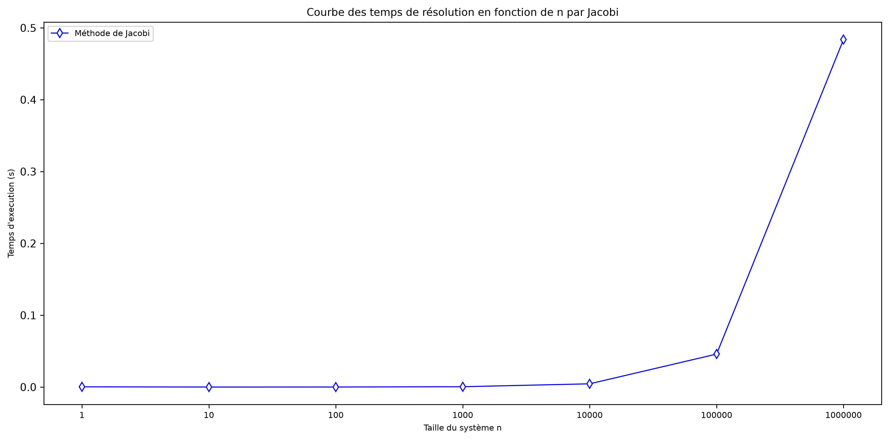
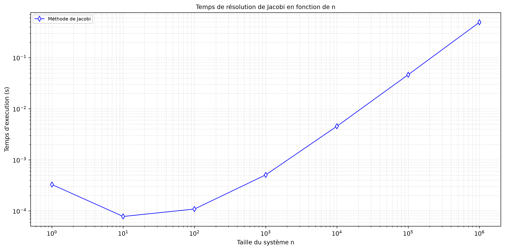

## Introduction
Ce TP sur le cours [@dolle2025], porte sur la résolution d'un système linéaire, l'un des piliers fondamentaux du calcul scientifique et de la simulation numérique. Ces systèmes linéaires issues de la discrétisation d'équations aux dérivées partielles (EDP) sont souvent de grande taille et sont de la forme $AX=B$. La matrice $A$ est de grande taille mais comporte beaucoup de coefficients nuls : elle est dite creuse (sparse). Ce TP a pour objectif de développer en Fortran un petit ensemble d’outils (programmes) pour manipuler de telles matrices et résoudre des systèmes linéaires avec la méthode itérative de Jacobi, puis d’évaluer ses performances. 


## Contexte et objectifs
Ce TP porte sur la résolution d'un système linéaire de la forme 
$$AX=B$${#eq-one}
par la méthode itérative de Jacobi. On considère $A\in M_n(\mathbb{R})$ creuse telle que $a_{i,j} = 0$ pour $j < i-1$ et $j > i+2$. L'objectif est de :

* Stocker la matrice creuse $A$ de taille $n$ arbitraire sous le format compressed sparse row **CSR**. Le format **CSR** est defini avec trois tableaux unidimensionnel, *val* pour les valeurs non nulles; *nnz* le nombre de valeurs non nulles cumulées par ligne, qui commence à $0$ et *icol* l'indice de colonne de la valeur non nulle. 

* Implémemter l'algorithme de Jacobi : résolution du système par la méthode de Jacobi, tester sur differents matrices et vérifier la convergence.

* Lancer une campagne de test de performance "benchmarks" pour analyser le temps de résolution en fonction de la taille $n$.

* Créer une interface (API) vers python pour afficher la courbe des temps de résolution du système linéaire en fonction de la taille $n$.


## Résultats et discussions
Dans cette partie, on veut résoudre le système linéaire @eq-one avec la méthode de Jacobi. Nous allons commencer par présenter l'algorithme de Jacobi; l'utilser dans notre programme pour résoudre pour $n = 100$ avec différents diagonales non nulles de notre matrice $A$. Ensuite, choisir un système basé sur une équation pour lancer un test "benchmarks" pour connaitre le temps de résolutions en fonction de $n$. Pour finir, nous allons afficher la courbe des temps de résolution du sytème en python grâce au module python qu'on aura crée.

### Méthode itérative de Jacobi
Les méthodes itératives introduites sont éfficace pour des problèmes en grande taille. Face aux contraintes de mémoire et de complexité algorithmique des méthodes directes (comme l'élimination de Gauss ou la factorisation LU), les méthodes itératives offrent une alternative efficace. Parmi elles, la méthode de Jacobi constitue une approche classique et facilement parallélisable pour approximer la solution $x$ d'un système linéaire $Ax=b$.

#### Algorithme de Jacobi

```{=latex}
\SetKw{Retourner}{retourner}
\SetKw{KwTo}{à}
\SetKw{KwDe}{de}
\SetKw{KwA}{à}
\begin{algorithm}[H]
\DontPrintSemicolon
\caption{Algorithme de Jacobi}
\KwDonnee{$ A \in M_n(\mathbb{R}),\ b \in \mathbb{R}^n, \ k_{max} \in \mathbb{N}^*, \   \epsilon \in \mathbb{R}_+^*$}
\KwResultat{$ x \in \mathbb{R}^n$}
Choisir $ x_0 \in \mathbb{R}^n$\;
\For{$k$ \KwDe $1$ \KwA $k_{\max}$ }{
  $Y_{k-1} = Ax_{k-1}$\;
  \eIf{$\|b -Y_{k-1}\|_2 < \epsilon $}{
    \Retourner $x_{k-1}$\;
  }{
   $ x_k = x_{k-1} - D^{-1}Y_{k-1} + D^{-1}b$\;
  }
}
\Retourner $x_{k_{\max}}$\;
\end{algorithm}
```
$D$ étant la diagonale de $A$.

#### Convergence
L'algorithme de Jacobi converge si la matrice $A$ est à diagonale strictement domminante i.e. 
$$ |a_{i,j}| \geq \sum_{i\neq j} |a_{i,j}| $${#eq-too}


#### Méthodes itératives vs méthodes directes
Pour les méthodes itératives, il n'est pas nécessaire de stocker explicitement la matrice $A$ sous forme dense, il suffit de pouvoir calculer les produits $Ax$. Ainsi, on réduit le cout en stockage mémoire. Les méthodes directes (telles que LU et Cholesky) souffrent d’une capacité limitée de parallélisation et d'un coût très cher en temps de calcul en raison des dépendances lors du pivotage. Par ailleurs, lorsque la taille de la matrice augmente, les matrices sont bien creuses mais le stockage associé aux méthodes directes devient très élevé $\mathcal{O}(n^2)$. Les méthodes directes sont efficaces dans le cas $1$D et $2$D de tailles modérée mais deviennent très lourdes en $3$D. Par conséquent, les méthodes itératives sont plus adaptés à des systèmes de grande taille $3$D et en particulier dans le cadre du calcul scientifique haute performance et les problèmes réalistes actuels. Néanmoins, les méthodes itératives nécessitent pour être éfficace d'être préconditionné face au mauvais conditionnement des matrices d'EDP.


#### Mise en oeuvre et tests
Dans cette partie nous réalisons nos tests avec une matrice $A$ à $4$ diagonales non nulles $a_1$, $a_2$, $a_3$, $a_4$ auxquelles nous attribuerons différentes valeurs; et nous utilisons pour la taille de la matrice $n=100$, le ,ombre d'itérations maximales $k_{\max}=1000$ et $\epsilon =10^{-7}$. Pour le second membre $b$, nous le prenons de maniere aléatoire.

**Condition suffisante de convergence** : $|a_2| \geq |a_1|+|a_3|+|a_4|$


1. Test 1
$a_1 = 1$; $a_2 = 2$, $a_3 = 3$, $a_4 = 4$.

On a : $|a_2|<|a_1|+|a_3|+|a_4|$

Avec ces valeurs de diagonales non nulles, on observe que la méthode de Jacobi atteint $k_{\max}$ sans converger. On peut dire que Jacobi ne converge pas selon notre critère de convergence. Mais, peut-être que si on augmente le nombre maximal d'itération, la méthode de Jacobi peut finir par converger pour cette matrice malgré que la matrice n'est pas à diagonale strictement dominante.

|Iterations ($k$)|$k_{\max}$| Résidu | Trace($A$) | Norme($A$)|
|--------------|---------|--------|----------|---------|
| NaN          | atteint | NaN    | 200      | 10      | 

\newpage

2. Test 2
$a_1 = 1$; $a_2 = 4$, $a_3 = 2$, $a_4 = 1$.

Cette matrice est à diagonale strictement dominante $|a_2| \geq |a_1|+|a_3|+|a_4|$ donc la méthode de Jacobi converge en $254$ itérations.

|Iterations ($k$)|$k_{\max}$ | Résidu    | Trace($A$) | Norme($A$)|
|--------------|-------------|-----------|----------|---------|
| 254          | pas atteint | 9.01e-008 | 400      | 8       | 


3. Test 3
$a_1 = -1$; $a_2 = 4$, $a_3 = -1$, $a_4 = -1$.

On remarque que cette matrice vérifie aussi la condition suffisante de convergence de Jacobi donc l'algorithme de Jacobi converge en $62$ itérations. Plus rapidement que celle d'avant. Cela s'explique par le fait que cette matrice est strictement à diagonale dominante i.e. $|a_2| > |a_1|+|a_3|+|a_4|$ alors que pour la matrice d'avant l'inégalité n'était pas stricte.

|Iterations ($k$)|$k_{\max}$ | Résidu    | Trace($A$) | Norme($A$)|
|--------------|-------------|-----------|----------|---------|
| 62           | pas atteint | 9.22e-008 | 400      | 7       | 

4. Test 4
$a_1 = -1$; $a_2 = 3$, $a_3 = -1$, $a_4 = 1$.

Pour cette configuration de matrice, l'algorithme de Jacobi converge en $306$ itérations. On remarque une fois de plus que l'inégalité de la condition suffisant e de convergence joue sur le nombre d'itérations.


|Iterations ($k$)|$k_{\max}$ | Résidu    | Trace($A$) | Norme($A$)|
|--------------|-------------|-----------|----------|---------|
| 306          | pas atteint | 8.96e-008 | 300      | 6       | 

On peut dire que notre algorithme de Jacobi fonctionne bien et donne des résultats cohérents avec ce que prédit la théorie. Il faut noter que le nombre d'itérations augmente en fonction de la taille de la matrice.


Pour reproduire les résultats obtenus en ligne de commande, il faudra utiliser les commandes suivantes :

```{.fortran}
gfortran -Wall -pedantic -o verifications matutils.f90 linearsolver.f90 
verifications.f90
./verifications
```
Aussi on pourra optimiser en faisant
```{.fortran}
gfortran -Wall -pedantic -O2 -o verifications matutils.f90 linearsolver.f90
verifications.f90
./verifications
```

Voici, un bout du code (boucle de sur Jacobi) du fichier module linearsolver.f90 qui contient l'algorithme de Jacobi

```{.fortran}
x = 0.0d0
do k = 1, kmax
    !calcul of y=Ax
  y=mat_vect(A,x) !y = A * x 
  !compute L2 error of residue
  r = sqrt(dot_product(b-y, b-y))
  if (r .LT. epsilon) then
     converge = .TRUE.
     exit
  else 
      x = x - y/D + b/D
  end if 
end do 
```

A présent, nous nous interessons au temps de calcul (temps de résolution de l'algorithme de Jacobi). Nous allons faire une campagne de "benchmarks" en construisant une procédure qui prend en entrée la taille de la matrice $n$ et retourne le temps de résolution. Pour s'y faire, nous avons choisi une matrice issue de la discrétisation d'une équation. Pourquoi ce choix ?

### Choix du système pour la procédure bench (la matrice d'équation)
Ici, nous voulons lancer une campagne de test "benchmarks" pour voir le temps de résolution de notre système choisi. Pour mener à bien cette évaluation, le choix du système linéaire $A x = b$ est un élément central. Nous avons retenu une matrice tridiagonale déterministe $(4,-1,-1)$ issue de la discrétisation par différences finies d'une équation de réaction-diffusion $1$D ($-\Delta u + c u = f$). Ce système présente des propriétés mathématiques et pratiques idéales pour le benchmark :

* Diagonale strictement dominante : $|a_{ii}| > \sum_{j \neq i} |a_{ij}|$ $(4>1+1)$  elle garantit théoriquement la convergence de l'algorithme de Jacobi et assure un nombre d'itérations stable face à l'augmentation de la taille $n$.

* Solution exacte connue $x = (1, \cdots, 1)$ : le second membre $b = Ax$ permet une validation de la méthode de résolution et un calcul précis de l'erreur d'approximation.

* Reproductibilité et efficacité : contrairement aux matrices aléatoires, qui risquent de diverger, coûtent $\mathcal{O}(n^2)$ en mémoire et manquent de reproductibilité, ce système déterministe permet d'isoler et de mesurer spécifiquement l'effet de la taille $n$ sur les performances.

Nous avons donc pour cela créer une interface python (API) pour automatiser l'exécution des benchmarks et tracer la courbe du temps de résolution en fonction de taille $n$.

### Fonctionnenement de l'interface python (API)

```{mermaid}
%%| eval: true
%%| fig-width: 5.5
flowchart RL
  C["<b>Python run_benchmarks.py</b><br/>choisit les tailles n à tester"] --> B["<b>F2PY Interface générée</b><br/>permet à Python d'appeler Fortran"]
  B --> A["<b>Fortran bench</b><br/>construit le système, exécute jacobi, renvoie le temps"]
  A --> B
  B --> C
```

#### Courbe des temps de résolution du système

Nous avons obtenu pour $n = 1, \cdots, 10^6$ les graphiques suivants:

<!--{width=14cm fig-align="center"}-->

{#fig-jacobi}

Sur la figure @fig-jacobi on voit l'évolution du temps de résolution en fonction de la taille de matrice $n$. On remarque une augmentation du temps quand la taille augmente. Ce qui est normale vu qu'on stocke les valeurs non nulles de la matrice, le nombre de valeurs non nulles augmente avec la taille et on a une complexité de calcul de $\mathcal{O}(n)$.

{#fig-jacobi_log}

La figure @fig-jacobi_log, montre l'évolution du temps de résolution en fonction de $n$ en log. On voit bien globalement une dépendance linéaire du temps en fonction de $n$ plus précisement à partir de $10^3$ sauf un bug au début qui est peut-être dû au fait que pour des petites tailles i.e $n=1$, l'algorithme de Jacobi peut être influencé par le chronométrage. 

\newpage

## Conclusion
Ce TP m'a permis d'apprendre le language FORTRAN par le développement d'un programme utilisant des procédures eux même à l'interieur des modules. Aussi d'experimenter les bases de la programmation orienté objet, surtout la visibilité qui permet de définir des API pour les utilisateurs toute fois en limitant l'accès aux variables et procédures. J'ai appris également l'interopérabilité avec le language Python. Ce travail avait pour objectif de créer un programme qui résout un sytème linéaire $Ax=b$ par la méthode itérative de Jacobi. Cet objectif a été atteint à travers des tests menés et des résultats obtenus. Les analyses ont permis de mettre en évidence la convergence de la méthode de jacobi si la la matrice est à diagonale strictement dominante. 


## References

::: {#refs}
:::

